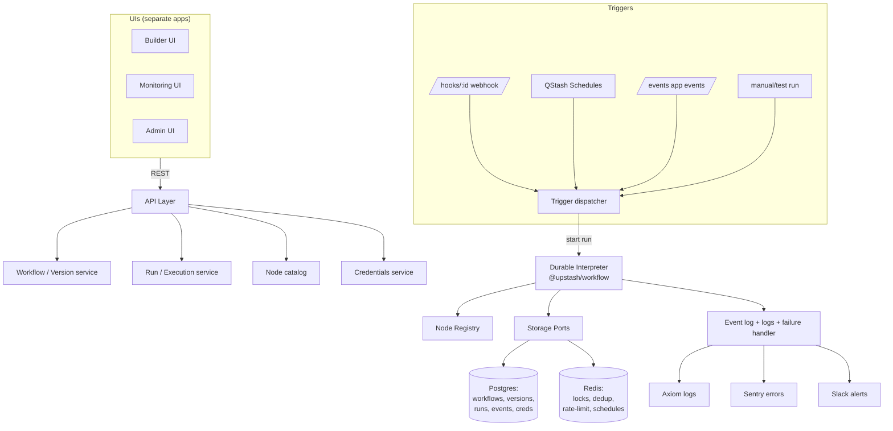

# Automations Platform — Design & Build Doc

A headless, n8n-style workflow engine built on **Upstash Workflow** (durable execution over QStash). Workflows are **data** (a graph of nodes) interpreted by a single generic engine. The backend exposes **UI-agnostic APIs** so multiple front-ends can build, run, and observe workflows.

> Status: design agreed. This doc is the build spec.

---

## 1. Goals & non-goals

### Goals
- **Cheap, no infra.** Pay-per-step on Upstash (~$0.00001/step). No servers to run.
- **Malleable.** Add a capability = register one **node type**; it's instantly available to every UI and every workflow. New *workflows* need no deploy at all (they're data).
- **Headless.** The product is a set of APIs + a durable engine. UIs are separate consumers.
- **Durable.** Long-running flows (multi-week email sequences) survive restarts, deploys, and edits.
- **Observable.** Per-workflow, per-run, per-node visibility — not just message delivery.
- **Swappable storage.** Engine depends on interfaces (ports); Postgres + Redis are the shipped defaults.

### Non-goals (for v1)
- Building the UI (separate project; we only expose APIs).
- A visual expression builder (we expose the expression *language*, UI renders it).
- Multi-region / self-hosted distribution of the engine.
- Real-time collaborative editing of workflows.

---

## 2. Architecture at a glance



**One engine endpoint** interprets **all** user workflows. Everything else is either an API, a trigger source, a storage adapter, or observability.

---

## 3. Core concepts

### 3.1 Workflow-as-data
A workflow is a **directed graph**: a trigger node plus action/control nodes connected by edges. Stored as JSON. Creating or editing a workflow is an API call — **never a deploy**.

### 3.2 Node registry
The only unit of *code-level* extensibility. Each node type declares:
- a **schema** (for UIs to render config forms), and
- an **execute** function (runtime behavior).

Add a node type → it appears in the catalog API → every UI can use it → every workflow can contain it.

### 3.3 Durable interpreter
A single Upstash Workflow handler loads a workflow definition and walks the graph, running each node as a durable step. Because Upstash **replays from checkpoints**, the interpreter obeys strict determinism rules (§6.2).

---

## 4. Data model

App-generated **ULIDs** for all IDs (store-agnostic, sortable). No DB-generated IDs.

### 4.1 Entities

```
Workflow
  id            ulid
  ownerId       string
  name          string
  status        'draft' | 'active' | 'disabled'
  activeVersionId ulid?         # which version new runs use
  trigger       TriggerConfig   # denormalized for fast dispatch
  createdAt, updatedAt

WorkflowVersion            # IMMUTABLE once created
  id            ulid
  workflowId    ulid
  version       int              # monotonic per workflow
  nodes         Node[]           # the graph
  edges         Edge[]
  createdAt

Node
  id            string           # unique within version (e.g. "n_send_1")
  type          string           # registry key, e.g. "email.send"
  params        Json             # static config + expressions
  position      { x, y }         # UI-only; engine ignores

Edge
  from          { nodeId, port }  # port enables branching (e.g. "true"/"false")
  to            { nodeId, port }

Run
  id            ulid
  workflowId    ulid
  versionId     ulid              # PINNED at start
  status        'running' | 'succeeded' | 'failed' | 'cancelled'
  trigger       Json              # input payload
  startedAt, finishedAt
  workflowRunId string            # Upstash ctx.workflowRunId (correlation)

RunEvent                          # append-only; powers observability + run detail
  id            ulid
  runId         ulid
  nodeId        string?
  type          'run.started' | 'node.started' | 'node.executed'
                | 'node.failed' | 'run.succeeded' | 'run.failed' | 'domain.*'
  input         Json?
  output        Json?
  error         Json?
  ts            timestamp

Credential
  id            ulid
  ownerId       string
  type          string            # 'resend' | 'slack' | 'http_bearer' ...
  ciphertext    bytes             # encrypted secret payload
  createdAt

EventSubscription                 # event-trigger routing
  id            ulid
  eventType     string            # 'app.installed' ...
  workflowId    ulid
```

### 4.2 Example workflow JSON (install → 7-day drip)

```json
{
  "trigger": { "type": "event", "eventType": "app.installed" },
  "nodes": [
    { "id": "t", "type": "trigger.event", "params": {} },
    { "id": "loop", "type": "control.loop", "params": { "times": 7 } },
    { "id": "send", "type": "email.send",
      "params": { "credentialId": "cred_x",
        "to": "{{ trigger.json.email }}",
        "templateId": "day-{{ loop.json.index }}" } },
    { "id": "wait", "type": "control.wait", "params": { "duration": "1d" } }
  ],
  "edges": [
    { "from": {"nodeId":"t","port":"out"},    "to": {"nodeId":"loop","port":"in"} },
    { "from": {"nodeId":"loop","port":"each"}, "to": {"nodeId":"send","port":"in"} },
    { "from": {"nodeId":"send","port":"success"}, "to": {"nodeId":"wait","port":"in"} },
    { "from": {"nodeId":"wait","port":"out"},  "to": {"nodeId":"loop","port":"in"} }
  ]
}
```

---

## 5. Storage layer (ports + adapters)

The engine depends on **narrow, capability-minimal interfaces**. Ship one adapter per concern; add more only when a real need appears (YAGNI).

### 5.1 Polyglot defaults

| Concern | Port | Default adapter | Why |
|---|---|---|---|
| Definitions/versions | `WorkflowRepo` | Postgres (JSONB) | Documents + queryable + transactional version bump |
| Runs + events | `EventLog` | Postgres | Append + aggregate (metrics, run detail) |
| Credentials | `CredentialStore` | Postgres | Small encrypted records |
| Hot state | `KVState` | **Upstash Redis** | Atomic `setNX`, TTL, counters — *not* abstracted away |

### 5.2 Port interfaces

```ts
interface WorkflowRepo {
  getWorkflow(id: string): Promise<Workflow>;
  list(ownerId: string, filter?: WorkflowFilter): Promise<Workflow[]>;
  setStatus(id: string, status: WorkflowStatus): Promise<void>;
  putWorkflow(w: Workflow): Promise<void>;               // upsert header fields
  getVersion(workflowId: string, versionId: string): Promise<WorkflowVersion>;
  listVersions(workflowId: string): Promise<WorkflowVersion[]>; // newest first
  createVersion(v: WorkflowVersion): Promise<void>;      // immutable
  activate(workflowId: string, versionId: string): Promise<void>; // atomic
}

interface EventLog {
  append(e: RunEvent): Promise<void>;
  createRun(r: Run): Promise<void>;
  updateRun(id: string, patch: Partial<Run>): Promise<void>;
  getRun(id: string): Promise<Run>;
  listEvents(runId: string): Promise<RunEvent[]>;         // run detail timeline
  query(f: RunQuery): Promise<RunSummary[]>;              // metrics; Redis adapter may throw Unsupported
}

interface CredentialStore {
  get(id: string): Promise<DecryptedSecret>;              // decrypts internally
  put(input: { id; ownerId; type; secret }): Promise<void>; // encrypts internally
  list(ownerId: string): Promise<CredentialMeta[]>;       // metadata only, never secret material
  delete(id: string): Promise<void>;
}

interface KVState {
  setNX(key: string, val: string, ttlSec: number): Promise<boolean>; // locks/dedup
  get(key: string): Promise<string | null>;
  incr(key: string): Promise<number>;                     // rate-limit
  del(key: string): Promise<void>;
}
```

### 5.3 Rules that keep swappability honest
1. **Don't abstract to the lowest common denominator.** `EventLog.query` is analytics-shaped on purpose; a Redis adapter is allowed to throw `UnsupportedOperation`.
2. **No cross-store transactions.** Achieve consistency via **idempotency** (ULIDs, upserts, `KVState.setNX` dedup) — required anyway because Upstash replays steps.
3. **Adapters return domain objects**, never raw rows.

### 5.4 Wiring

```ts
export const store = {
  workflows:   mkWorkflowRepo(env.WORKFLOW_STORE ?? "postgres"),
  events:      mkEventLog(env.EVENT_STORE ?? "postgres"),
  credentials: mkCredentialStore(env.CRED_STORE ?? "postgres"),
  kv:          mkKVState("redis"),   // always Redis
};
```

---

## 6. Execution engine (the durable interpreter)

### 6.1 One handler for all workflows

```ts
export const engine = serve(async (ctx) => {
  const { workflowId, versionId, trigger } = ctx.requestPayload;

  // STEP 1 — pin definition (checkpointed & immutable for this run)
  const def = await ctx.run("load-def", () =>
    store.workflows.getVersion(workflowId, versionId));

  await ctx.run("run-started", () =>
    store.events.append({ runId: ctx.workflowRunId, type: "run.started", input: trigger }));

  const outputs: Record<string, any> = { trigger };
  let frontier = startNodes(def);           // nodes after the trigger

  while (frontier.length) {
    const node = frontier.shift()!;
    const type = registry.get(node.type);

    if (type.kind === "wait") {
      await ctx.sleep(`sleep:${node.id}`, resolveDuration(node, outputs));
    } else {
      const inputs = resolveInputs(node, def, outputs);   // expression eval (§7)
      outputs[node.id] = await runNode(ctx, node, type, inputs);
    }
    frontier.push(...nextNodes(def, node, outputs[node.id])); // follow edges / branch port
  }

  await ctx.run("run-succeeded", () =>
    store.events.append({ runId: ctx.workflowRunId, type: "run.succeeded" }));
}, {
  failureFunction: onWorkflowFailure,   // §11
});

async function runNode(ctx, node, type, inputs) {
  return ctx.run(`node:${node.id}`, async () => {
    const started = { runId: ctx.workflowRunId, nodeId: node.id, type: "node.started", input: inputs };
    await store.events.append(started);
    try {
      const creds = node.params.credentialId
        ? await store.credentials.get(node.params.credentialId) : undefined;
      const out = await type.execute({ inputs, params: node.params, creds, ctx });
      await store.events.append({ ...started, type: "node.executed", output: out });
      return out;
    } catch (e) {
      await store.events.append({ ...started, type: "node.failed", error: serializeErr(e) });
      throw e;
    }
  });
}
```

### 6.2 Determinism rules (non-negotiable)
Upstash re-executes the handler from checkpoints, so structure must be stable across replays:

1. **Pin the definition in step 1.** Load the *version* once, checkpoint it. Edits mid-run don't affect in-flight runs.
2. **Stable step IDs from node IDs.** `node:${node.id}`, loops use `node:${node.id}:${index}`. Same graph → same IDs → durability holds.
3. **No wall-clock / randomness outside a step.** All non-determinism lives inside a node's `execute` (which is itself wrapped in `ctx.run`).
4. **Idempotent side effects.** `execute` may re-run on retry; use idempotency keys (email sends, HTTP POSTs) via `KVState.setNX`.

### 6.3 State passing
`outputs[nodeId]` holds each node's result in-memory for the current handler invocation; Upstash restores prior step results on replay. The **durable source of truth for observability** is the `RunEvent` log, not memory.

### 6.4 Control-flow nodes
- **`control.wait`** → `ctx.sleep` / `ctx.sleepUntil` (billed as 1 step; long delays are otherwise free).
- **`control.if` / `control.switch`** → evaluate condition, emit on the matching output port; `nextNodes` follows only that edge.
- **`control.loop` / `control.splitInBatches`** → iterate with indexed step IDs; **cap iterations** (config + hard ceiling) to bound step cost.
- **`control.merge`** → wait for multiple inbound ports (join). Use `ctx` parallel primitives for fan-out/fan-in.

---

## 7. Node registry & contract

### 7.1 Defining a node

```ts
export const emailSend = defineNode({
  type: "email.send",
  kind: "action",                 // 'trigger' | 'action' | 'wait' | 'control'
  category: "Email",
  label: "Send Email",
  inputSchema: z.object({
    to: z.string(),
    templateId: z.string(),
    vars: z.record(z.any()).optional(),
  }),
  outputs: ["success", "error"],  // → edge ports
  credentials: ["resend"],        // required credential types
  async execute({ inputs, creds }) {
    const idem = `email:${inputs.to}:${inputs.templateId}`;
    if (!(await store.kv.setNX(idem, "1", 86400))) return { skipped: true }; // dedup
    return resend(creds).send(inputs);
  },
});
```

### 7.2 Schema → UI
Node `inputSchema` (Zod) is converted to **JSON Schema** (`zod-to-json-schema`) and returned by the catalog API. UIs render config forms generically — they never hard-code node knowledge.

### 7.3 Starter catalog
Implemented:
- **Triggers:** `trigger.webhook`, `trigger.schedule`, `trigger.event`, `trigger.manual`
- **Actions:** `http.request` (SSRF-safe), `email.send` (Resend), `email.smtp` (nodemailer), `slack.post`
- **AI:** `ai.complete` (with optional conversation `memory`), `ai.image`, `ai.transcribe`, `ai.tts`, `ai.agent` (bounded tool-calling loop over allowlisted catalog nodes) — all via OpenRouter (one `openrouter` credential, model-dependent). Video generation isn't offered by OpenRouter → needs a dedicated provider.

**Memory** is a `ConversationStore` port (Redis list per key; in-memory for tests), owner-scoped by key; `ai.complete { memory: { key, window } }` loads prior turns and appends each turn. **Tools** reuse the node registry: an `ai.agent` tool's JSON-Schema *is* the target node's `inputSchema` and its executor *is* the node's `execute` — the model can only call allowlisted node types, bounded by `maxSteps`, each tool run getting a unique `stepId`.

**Durable nodes** (`durable: true`, e.g. `ai.agent`, `control.approval`) are *not* wrapped in a single step; they own their sub-steps via `rt.step(subId, fn)` and `rt.waitForEvent(eventId, timeoutSec)`, each checkpointed at the top level (so a long agent loop / a multi-day approval wait resumes rather than re-running). **Human approval**: `control.approval` announces (Slack/log) a stable `eventId` then suspends via `waitForEvent`; a decision is delivered with `POST /approvals { eventId, approved, data }` (QStash `notify` in prod; local mode auto-approves). Routes to `approved` / `rejected`. The **agent** can also gate individual tools: mark a tool `requireApproval: true` and it suspends before that call — approved → runs; denied/timeout → the denial is fed back to the model as the tool result (it doesn't run).
- **Control:** `control.wait`, `control.if`, `control.switch`, `control.loop`, `control.filter`, `control.approval` (human-in-the-loop; durable)
- **Data:** `data.set`, `data.transform`
- **Utility:** `util.log`

Deferred: `control.merge` (explicit join), `control.splitInBatches` (per-item iteration), `data.code` (JS sandbox).

---

## 8. Expressions & data mapping

Nodes reference upstream data with expressions, e.g. `{{ trigger.json.email }}` or `{{ node["send"].json.id }}`.

- **Language: JSONata** (declarative, expressive, safe). Default choice.
- **Never `eval` arbitrary JS.** The `data.code` node runs in a **sandbox** (QuickJS / `isolated-vm`) with no network/FS and a CPU/time budget.
- `resolveInputs` walks a node's `params`, evaluates any `{{ ... }}` expression against the `outputs` map, and returns concrete values validated by `inputSchema` before `execute`.

---

## 9. Triggers

| Trigger | Mechanism | Flow |
|---|---|---|
| **Webhook** | `POST /hooks/:workflowId` | Body becomes `trigger`; starts a run |
| **Schedule** | QStash Schedule per active workflow | On activate, register cron → engine; on disable, delete |
| **Event** | Apps `POST /events {type, payload}` | `EventSubscription` maps type → workflow(s); start each |
| **Manual/Test** | `POST /workflows/:id/execute` | Run with sample/real input |

Dispatcher responsibility: resolve `activeVersionId`, then `client.trigger({ url: ENGINE_URL, body: { workflowId, versionId, trigger } })`.

**Cost tip:** for pure monitoring, a QStash Schedule hitting a plain endpoint (no durable engine) is cheapest; use the engine only when you want per-node observability or branching.

---

## 10. Credentials & secrets

- Stored **encrypted at rest** (AES-256-GCM; key from env/KMS, not in DB).
- Nodes reference a `credentialId`; the engine decrypts and injects at runtime inside `runNode`.
- `CredentialStore.list` returns **metadata only** — secret material never leaves the engine.
- Rotate by adding a new credential and repointing nodes; old versions keep their pinned reference.

---

## 11. Versioning & failure semantics

### Versioning
- `WorkflowVersion` is **immutable**. Editing creates a new version + bumps `activeVersionId` (atomic).
- **Runs pin their version at start** → multi-week sequences finish on the graph they began with. New runs use the active version.
- Deleting a workflow soft-disables it; in-flight runs continue (they hold their pinned version).

### Failure handling
- `failureFunction` fires when a run exhausts retries → write `run.failed` event, alert Slack + Sentry with `{workflowId, runId, failedNodeId}`.
- Monitor the **QStash DLQ**; a scheduled job alerts if depth > 0.
- Per-node retries use Upstash defaults (3×); make `execute` idempotent so retries are safe.

---

## 12. API surface (headless product)

REST, JSON, ULID paths. Auth via API key / JWT per owner. All list endpoints paginate.

### Catalog
```
GET  /node-types                 → [{ type, app, label, category, kind, inputSchema(JSONSchema), outputs, credentials }]
GET  /node-types?grouped=true    → [{ app, label, nodes: [ …entries ] }]   (n8n-style integration grouping)
GET  /node-types/:type
```
Each node declares an optional `app` (integration id, e.g. "google-sheets"); it
defaults to the `type` prefix. `?grouped=true` buckets node types by `app` so a
UI can show one "Google Sheets" entry that expands into its actions.

### Workflows & versions
```
POST   /workflows                → create (draft)
GET    /workflows                → list (filter: status, ownerId, q)
GET    /workflows/:id
PUT    /workflows/:id            → creates a new version (immutable)
DELETE /workflows/:id            → soft-disable
GET    /workflows/:id/versions
POST   /workflows/:id/activate   { versionId }  → set active + register/refresh triggers
POST   /workflows/:id/disable
```

### Validation & testing
```
POST /workflows/:id/validate     → { ok, errors[] }  (cycles, unknown nodes, missing required params, orphans, bad ports)
POST /workflows/:id/test-node    { nodeId, sampleInput }  → runs one node, returns output   ← key DX feature
POST /workflows/:id/execute      { input }  → starts a run (manual/test), returns runId
```

### Runs & observability
```
GET /runs?workflowId=&status=&from=&to=   → paginated summaries
GET /runs/:id                              → status + timeline (per-node input/output/error)
GET /runs/:id/events                       → raw RunEvent stream
POST /runs/:id/cancel
GET /metrics?workflowId=&window=           → counts, success/failure rate, step count  (EventLog.query)
```

### Credentials
```
POST /credentials    { type, secret }   → returns metadata only
GET  /credentials    → metadata list
DELETE /credentials/:id
```

### Triggers
```
POST /hooks/:workflowId          → webhook entrypoint (public, signed)
POST /events   { type, payload } → app event ingress
GET/POST/DELETE /subscriptions   → event→workflow routing
GET  /schedules                  → active QStash schedules
```

### Standard response envelope
```json
{ "data": {}, "error": null, "meta": { "requestId": "...", "cursor": "..." } }
```

---

## 13. Observability (layered)

| Layer | What | Tool |
|---|---|---|
| 0 | Message delivery, retries, DLQ | Upstash/QStash console (built-in) |
| 1 | Structured step logs (correlated by `workflowRunId`) | **Axiom** |
| 2 | Failures & errors → alerts | `failureFunction` → **Slack** + **Sentry** |
| 3 | **Business/run event log** (per-instance timeline + metrics) | `EventLog` (Postgres) → optionally Tinybird at scale |
| 4 | Tracing (optional; beware replay double-counting) | Sentry/OTel |

**Correlation key:** thread `ctx.workflowRunId` into every log line and `RunEvent`. Instrumentation lives in `runNode` (§6.1) so **every node type is observable automatically** — no per-node opt-in.

---

## 14. Cost model

- **Unit:** 1 step ≈ 1 QStash message ≈ **$0.00001** (`$1 / 100K`), pay-as-you-go, no floor. `context.call` = 2. `sleep` = 1 (long delays otherwise free).
- **Per workflow run ≈ number of nodes executed** (+1 load, +1 start, +1 finish).
- Worked example: install 7-day drip ≈ 15 steps × 7,500/mo ≈ 112K steps ≈ **~$1.12/mo**.
- Surface **step count per run** in run detail so expensive graphs are visible.
- **Guardrails:** cap loop iterations; batch monitoring (one run checks N services, fan out only on failure); prefer a plain scheduled endpoint over the engine for pure polling.

---

## 15. Security

- **Expression/code sandboxing** is a trust boundary — treat user expressions and `data.code` as hostile (QuickJS/`isolated-vm`, no net/FS, time budget).
- **Secrets** encrypted at rest; decrypted only inside the engine; never returned by APIs.
- **Webhook signing** on `/hooks/:id` (HMAC) to prevent spoofed triggers.
- **SSRF protection** on `http.request` (block internal IP ranges / metadata endpoints; allowlist optional).
- **Tenant isolation** on every query (`ownerId` scoping).
- **Rate-limit** trigger ingress via `KVState.incr`.

---

## 16. Tech stack

| Concern | Choice | Notes |
|---|---|---|
| Language | TypeScript | |
| API framework | **Hono** | Portable (Vercel/CF/Node); Upstash Workflow adapter exists. Next.js App Router is a fine alt. |
| Durable engine | `@upstash/workflow` | over QStash |
| Validation / schema | **Zod** + `zod-to-json-schema` | one source for runtime + UI forms |
| Postgres | **Neon** + **Drizzle** | serverless, cheap |
| Redis | **Upstash Redis** | hot state |
| Expressions | **JSONata** | + QuickJS for `data.code` |
| Logs / errors | **Axiom** / **Sentry** | |
| Email / Slack (nodes) | Resend / Slack SDK | first connectors |

---

## 17. Build order (milestones)

**M1 — Skeleton**
- Repo, Hono app, env config, `store` wiring (Postgres + Redis adapters), Drizzle schema/migrations.
- Port interfaces + Postgres/Redis default adapters.

**M2 — Definitions API**
- Workflow/Version CRUD, immutability, `activate`, validation endpoint.
- Node registry + `GET /node-types` (schemas).

**M3 — Interpreter (linear)**
- `engine` handler, `load-def` pinning, `runNode` with event logging.
- 6 nodes: `trigger.event`, `trigger.webhook`, `trigger.schedule`, `email.send`, `control.wait`, `control.if`.
- This alone runs the **install / uninstall / subscribe** flows.

**M4 — Triggers**
- `/hooks/:id`, `/events` + subscriptions, QStash schedule registration on activate.

**M5 — Observability**
- `EventLog`, `/runs`, `/runs/:id` timeline, `failureFunction` → Slack/Sentry, Axiom logging.

**M6 — DX**
- `test-node`, full graph validation, `/metrics`.

**M7 — Advanced nodes**
- Branching/`switch`, `loop`/`splitInBatches`, `merge`, JSONata expressions, `data.code` sandbox, credentials + encryption, `http.request` (SSRF-safe), `slack.post`.

---

## 18. Open questions
- Expression ergonomics: pure JSONata vs a friendlier `{{ }}` templating layer on top?
- Do UIs need workflow *simulation/dry-run* (no side effects) beyond `test-node`?
- Multi-tenant credential sharing model (per-owner vs per-workspace)?
- Retention policy for `RunEvent` (hot in Postgres N days → cold in object storage/Axiom)?
- Do we need human-in-the-loop nodes (`waitForEvent`) in v1? (Upstash supports it natively.)

---

## Appendix A — Determinism checklist (per node author)
- [ ] `execute` is idempotent (safe to retry).
- [ ] Side effects guarded by an idempotency key (`KVState.setNX`).
- [ ] No reliance on wall-clock/random outside the step.
- [ ] Inputs validated against `inputSchema` before use.
- [ ] Secrets accessed only via injected `creds`.

## Appendix B — Glossary
- **Step / message:** one Upstash-billed unit (a `ctx.run`/`sleep`/etc.).
- **Run:** one execution of a workflow instance.
- **Version:** an immutable snapshot of a workflow graph.
- **Node type:** a registered, reusable capability.
- **Port:** a named input/output on a node (enables branching) *and* a storage interface (overloaded term — context disambiguates).
